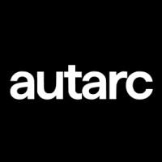
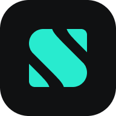

# AI Builder internships

[All job listings](https://github.com/noah-42/job-listings) · [Internship directory](README.md) · [CSV](data/2-jobs.csv) · [JSON](data/3-jobs.json)

🇬🇧 English sufficient · 🇩🇪 German required · Unclear: not confirmed. Language is separate from degree/enrollment eligibility. Nearby non-Berlin locations are labeled.

| Logo&nbsp;&nbsp;&nbsp;&nbsp;&nbsp;&nbsp;&nbsp;&nbsp;&nbsp;&nbsp;&nbsp;&nbsp;&nbsp;&nbsp;&nbsp;&nbsp;&nbsp;&nbsp;&nbsp;&nbsp;&nbsp;&nbsp;&nbsp;&nbsp; | Company | Title | Posted (2026) | Location | Pay range | Language | Requirements |
| :---: | :--- | :--- | :--- | :--- | :--- | :--- | :--- |
|  | [Enpal](https://www.enpal.de/) | [Praktikum AI &amp; Automation – Virtual Power Plant](https://jobdropberlin.com/jobs/enpal-praktikum-ai-and-automation-virtual-power-plant) | Nov-12 | Berlin, BE, DE | Not stated | 🇩🇪 | Business/tech studies or related experience; prior relevant internship; AI/automation tools; at least 4 months; German and English |
|  | Inca | [AI Builder Intern](https://jobdropberlin.com/jobs/inca-ai-builder-intern) | Nov-10 | Berlin, BE, DE | Not stated | 🇩🇪 | Advanced or recently completed quantitative studies; 6 months full-time; German work authorization; German and English; project links |
|  | [Augustus](https://augustus.com/) | [Internship](https://jobs.ashbyhq.com/augustus/5208e27a-2bca-498e-a7e1-efb981279847) | Nov-05 | Berlin | €2.5K per month | Unclear | Pursuing/completed bachelor or master; 1-2 internships or initiative through projects; 4 months; Berlin or relocation |
|  | [Langdock](https://langdock.com/) | [Build Your Own Internship – m/f/d (min. 6 Months)](https://jobdropberlin.com/jobs/langdock-build-your-own-internship-m-f-d-min-6-months) | Nov-05 | Berlin, BE, DE | Not stated | 🇬🇧 | Shipped AI project; Loom demo required; clear English, German a plus; 6+ months full-time; 100% Berlin office; German work permit |
|  | [Superchat](https://www.superchat.com/) | [Intern AI Adoption &amp; Product Marketing](https://jobdropberlin.com/jobs/superchat-intern-ai-adoption-and-product-marketing) | Nov-04 | Berlin, BE, DE | Not stated | 🇩🇪 | Detailed qualifications not stated in API text; work includes AI adoption/customer success, operations and product marketing; Berlin office |
|  | [Traide AI](https://traide.ai/) | [Internship Founders Associate to the Chief of Staff](https://jobdropberlin.com/jobs/traide-ai-internship-founders-associate-to-the-chief-of-staff) | Nov-03 | Berlin, BE, DE | Not stated | 🇩🇪 | Late bachelor or master; prior fast-paced project experience; German C1/native and English B2+; organized, hands-on |
|  | [Heidi Systems](https://heidisystems.com/) | [AI Agent Builder (Claude/OpenAI) - Intern](https://www.arbeitnow.com/jobs/companies/heidi-systems/ai-agent-builder-claude-openai-intern-berlin-206115) | Nov-03 | Berlin | Not stated | 🇩🇪 | Detailed qualifications not stated in API text; work includes Claude/OpenAI agents, LLM integration and prompt/workflow testing; Berlin or remote |
|  | [Enpal](https://www.enpal.de/) | [Process Automation Engineer - Internship (f/m/d)](https://jobs.ashbyhq.com/enpal/8c407089-cfdb-47b8-9e35-de7ce3073148) | Nov-02 | Berlin | Not stated | 🇬🇧 | Technical background or business profile with tech skills; Python/programming and Git; fluent English, German a plus; 6 months full-time |
|  | [autarc](https://www.autarc.energy/) | [Praktikum / Werkstudent (m/w/d) im AI-SAAS Vertrieb](https://autarcenergy.jobs.personio.de/job/2845630) | Oct-16 | Berlin | Not stated | 🇩🇪 | Enrolled student; software sales interest; fluent German; HubSpot/le ad-generation experience a plus; Berlin hybrid 3 days office |
|  | [GeneralMind](https://www.generalmind.com/) | [Value Delivery Intern - Automations](https://join.com/companies/generalmindcom/16832029-value-delivery-intern-automations) | Oct-15 | Berlin, Germany | Not stated | Unclear | 4 months full-time, 40h/week; on-site Berlin; enterprise AI automation; 2-month probation |
|  | [distil labs](https://www.distillabs.ai/) | [Machine Learning Science Intern](https://databerlin.net/jobs/machine-learning-science-intern-at-distil-labs) | Oct-14 | Berlin, DE | Not stated | Unclear | Current related PhD enrollment; Python and modern ML framework; 4-6 months full-time; EU time zones; quarterly Berlin on-site weeks |
|  | [Liqid Lig](https://liqid.de/) | [Business Automation &amp; AI Intern/Working Student (f/m/d)](https://www.arbeitnow.com/jobs/companies/liqid-lig/business-automation-ai-intern-working-student-berlin-6500) (API inactive; availability unconfirmed) | Oct-12 | Berlin | Not stated | 🇬🇧 | Business/technical curiosity; LLM applications and process automation; stakeholder communication; very good English, German a plus |
|  | [Bayer](https://www.bayer.com/en) | [Agentic AI Internship (All Genders)](https://talent.bayer.com/careers/job/562949978699007) | Oct-06 | Berlin,Berlin,Germ any | EUR 2395.0 - month | 🇬🇧 | Final-year related student; AI full-stack application experience; confident English; 6 months from Jan 2027; CV, cover letter, transcripts |
|  | [LIQUID](https://www.liquid.trade/) | [Product Builder Intern - Growth](https://www.joblyst.tech/jobs/post/4816fcd0-819f-4473-95ad-9568e0c1cb31) | Oct-06 | Berlin | Not stated | Unclear | Enrolled related bachelor/master; shipped project link; coding, ideally JS/TS and React; Git; AI coding tools |
|  | [1KOMMA5˚](https://1komma5.com/de/) | [Internship AI &amp; Automation - Energy (m/f/d)](https://1komma5grad.jobs.personio.de/job/2800670) (API inactive; availability unconfirmed) | Sep-16 | Berlin, Hamburg, München | Not stated | 🇩🇪 | Relevant studies or demonstrable technical experience; n8n/Make/Zapier; German C1; 5+ months, ideally 6 |
|  | [GeneralMind](https://www.generalmind.com/) | [AI Engineering - Intern](https://jobdropberlin.com/jobs/generalmind-ai-engineering-intern) | Sep-14 | Berlin, BE, DE | Not stated | Unclear | Related studies/recent graduate or self-taught portfolio; shipped projects; frontend/backend; Python and JS/TS; practical LLM work |
|  | [Perplexity AI](https://www.perplexity.ai/) | [Internship - Machine Learning Research Engineer](https://jobs.ashbyhq.com/perplexity/b9e1ff15-d52a-46d5-abf0-26460f2a116c) | Sep-02 | Berlin | Not stated | Unclear | Search/retrieval evaluation; PyTorch and distributed training; representation learning; AI/ML publication record |
|  | [Capgemini](https://www.capgemini.com/) | [Praktikant*in - Data Science / Analytics / GenAI (w/m/d)](https://databerlin.net/jobs/praktikantin-data-science-analytics-genai-wmd-at-capgemini) | Jul-31 | Berlin, DE | Not stated | 🇩🇪 | Advanced related studies; 2-3 data/ AI/programming/clo ud areas; Python/SQL; very good German and English |
|  | Scalable Capital | [Internship: AI/ML Engineering (m/f/x)](https://jobs.smartrecruiters.com/scalablegmbh/744000156493644) (API reconciliation pending) | Unknown | API reconciliation pending | Not stated | Unclear | API reconciliation pending |
|  | Lyceum | [Forward Deployed Engineer: AI Inference (Intern)](https://jobs.ashbyhq.com/Lyceum/7483d9e7-f14f-4315-81a9-dc560419d749) (API reconciliation pending) | Unknown | API reconciliation pending | Not stated | Unclear | API reconciliation pending |
|  | autarc | [GTM Engineering, AI &amp; Automation Internship (all genders)](https://autarcenergy.jobs.personio.de/job/2777192) (API reconciliation pending) | Unknown | API reconciliation pending | Not stated | Unclear | API reconciliation pending |
|  | [Tesla](https://www.tesla.com/) | [Machine Learning Intern, Generative SI Applications (m/f/d) - Gigafactory Berlin-Brandenburg](https://www.tesla.com/careers/search/job/287334) | Unknown | Berlin | Not stated | Unclear | Not stated: API description missing; requirements need upstream completion |
|  | ama | [Product Intern (Applied AI)](https://www.heyama.ai/careers/product-intern-(applied-ai)) (API reconciliation pending) | Unknown | API reconciliation pending | Not stated | Unclear | API reconciliation pending |
| Pending | [platoapp](https://platoapp.com/en) | [Forward Deployed Engineer Intern platoapp Berlin Reopened 6 hours ago Data &amp; AI AI Engineering Intern German required](https://www.joblyst.tech/jobs/post/ee261d21-82ea-4dbd-b280-091f16320821) | Unknown | Not stated | Not stated | 🇩🇪 | Technical background; coding/projects and customer-facing experience; SQL/Python; fluent German; communication |
| Pending | [Deutsches Zentrum für Luft- und Raumfahrt](https://www.dlr.de/de) | [Praktikum Parkausl astungsindex-Studi erende (w/m/d) der Verkehrsingenieurw issenschaft,Inform atik o.ä.](https://jobs.dlr.de/job/Berlin-Praktikum-Parkauslastungsindex-Studierende-%28wmd%29-der-Verkehrsingenieurwissenschaft%2CInformatik-o_%C3%A4_/1394279333/) | Unknown | Berlin | Not stated | 🇩🇪 | Related university studies; AI-model training; MATSim/traffic models; Python data analysis; GIS basics; German and English |

Dates are source posting dates (Mon-DD; header gives the year), not scrape dates. Exports retain ISO dates. Not stated means the source gives no usable value. Pay includes currency and period only when supplied; no unsupported estimates. [Source notes](sources.md).
