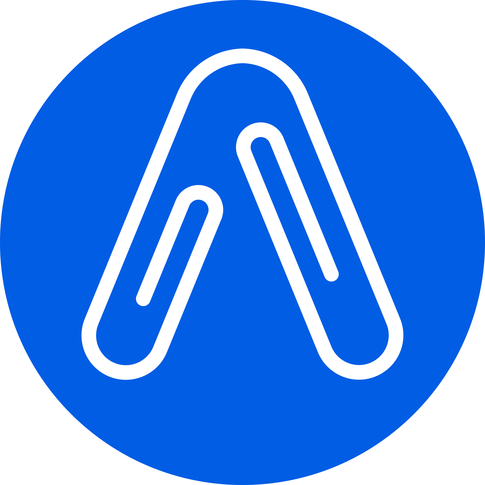

# Software Engineering internships

[Back to directory](README.md) · [Combined CSV](data/2-jobs.csv) · [Combined JSON](data/3-jobs.json)

**Language:** 🇩🇪 German required · 🇬🇧 English sufficient · **Unclear** not confirmed. Language is separate from eligibility. API-listed means Jobscout marked it active, not a fresh employer check. Missing logos are tracked for research. API check Nov 12, 2026, 15:03 CET.

### Posted in 2026

| Logo&nbsp;&nbsp;&nbsp;&nbsp;&nbsp;&nbsp; | Company | Role | Posted | Language | Skills (Req.) |
| :---: | :--- | :--- | :--- | :---: | :--- |
|  | [Amazon Europe Core](https://www.amazon.com) | [Software Dev Engineer Internship - Embedded Development](https://englishjobs.de/clickout/97087ab7d921320e?ql=l&sig=9a8569c245c090a8f311545d8984d013bb4ac6d0&e=FMhPf88KN_8EnkDGZezc-NA1o2HOvMWitdDAwMr-GsK0TJcG3WVkN1qSoGZCxLfs-aCs7gVlueG2ldVeO0RwbZRBA5WX_D2SUAJos0RRwTdYjt2pdoUiXxRe_quodijyuKAlF1hebK-KzAEqEGfig0_ibNZd8B0cypm_pu6UJZQg8DCNI1Glh9ZMIy8uOeYWuaz5x6NgpJSXAbPDfTlaTFpBrW_h2u65Gk_XUvJ7R5C1-VM39xAemanA2FQrPBbYIC5t-Vc8-NczK8ebgHpfzxOicwGGK0OynqvbgoATt_1SiGGWuJDYn6xYZBAyIm9ru1vjMYo3keES2tSUUi_HKyKEIv1PPQxEY87gjRi5H1EzgWbaSpm5sd9bS5lmY3ycP4TDPqJCIkowf24C6vqj9ivf9KuC8TK2HNOk5WmGeffpEjKX-yWYLVRbVGwiP1BumWddz0r7iznSN5D_CcGzRhWv2pR63KoqgWbnpD_hHFD1qeccUcVY5F2UEKlhmnRXWRqNv1NjiwP4UsV3CyuFMT3w2LlHSlzu6yYZUXG0BdOlfkzsj07_U5r8WBJ-TakhYIuKCGYgL6_29qsxOULD1lcRzQo2QNf_JLvRgoK1SYYRmVu97TqlY2CNv6r-tXLgUf7JZjb9dCel-AgeTsMUkWuHiUT5KdQbPDT86gw2L60jABqMBKT-HyZPAxuorHwQn4zoEQJJp2YSxKDQ4yQw8jA3x1xZlR3SozY8wSwBtS201RO0fkSlCni1hrU4eHQ26XixWzi49lkB-0SRpRqq2misXTUKXKtVXtK7of1VEAR4Q90_H9pyQvM8-kgjpe730cEmW0ba50MX2y61hZfEQi85MzhGGPTYaWBgoPsGq9VT5-436ittMLC2M67czW_ipM8xm3ElgNWW2UCrfZqQRzBjGOEO4428e7fx6PP5QpshoAGf3YSaD_JPMEFMl1qqn_-k8vmCEMW93ge2p6cNX7wLEpJqude7Qw9E60vgzTQjA-D662ISsAwUbNtLegl9xatT65BwYGgwGQTncuHZAAXSZz4UXu1eX1NHWSGICZb640BoThbVS_s-Chtzx-CxkskDbBaQXXvKPYvq6jd7ZsB_rnDIEdeKaARRwfO1X0rV5ih0tgBkDEwoSXNosPnxkNlUpCEm5qqCJUA53yDSDoUt8vWiUI9aNyx9RrcmoEAJKnGnwTSMjKZpldTbH5AXv0Xlqx0_HnbA-Jk4rDGANAJB3DU72nPB1cNXEh3SP7hGXUsk2vfiJAXovLIqRub9LoUstdkTqKOM70jLY3RpYFk--dl2A3gB97eSt5D57AZP-jErO8F576OMKjXmh_IP046BRgqShtYOzjyl-LhMJ3x6OlujAsq97a3aOpvPtZoRd3Dte8QDYUVsQzLnfoZ74xJEaf9ps4OnlpXNz6ChXMVDAfez2nPDea1S9dkaowyXnc-h7s2Ps-tbvIZuk9haxeKApVxo6zKosgMbTC8Sjtqxx1ltj2DmmSEthhNs-Q0RA4nKrFlTPTjkfvY8qVJN3BOyzVZM4ig92tONkZlqm_jEKi4ht7SUqQLT15jQ6JSUhdbsF72csIIoVAi07-vbrA6BFIwUTg_gFso0UhZmfUL7W7c7qQ&prev=RQ04B613BB1A2AA5&p=6&pg=3&w=1920) 18+; related degree/current study; graduation Oct 2026-Sep 2029; 3-6 months, full-time Jobscout #2508293; API-listed; employer not rechecked | Oct-30 | Unclear | One general-purpose language; data structures, algorithms and OOP |
|  | [Amazon Europe Core](https://www.amazon.com) | [Software Dev Engineer Intern](https://englishjobs.de/clickout/81af0f21df98baa7?ql=l&sig=a53128f1ea2e2345622701f48fc91fde0209013a&e=_FjM1lJNJshpIV2kVPz0Ps6C-WCwpvyUQaExvb1DhosCvvnnsNcOt3Z8Wkmh6UODm8RCt6ikC8e5eLNokCFKdPzJRDE305rlKTCL2thxFkHV1Tc3eiBLSUvNeYmxnMSpUbJGS7frHsU0bUPBLB5sL2xdX4S0X3fJWSrcmhDcA7FghSZzXQWR7LcAkk4y2D8kEyw9Rgz44nAJJr03xdl219n6RV7Fg3v2F7YiXek-_31-QZ4oVGCcULctf13VUxzfpJiied-rcXfhOgnVh0P1deh0A3wDom3YhYNyfETzszEdQ4iWpTWLZ28LHNdAo_4s8Yr7D92VlwyS8HXcqkWkLAXWwQTgpPpq9R7I-RrpxqX4oM4C_AWlcwASQkXIg5beM0q-LlRDcXxhB2BdT0y3dAt8o0pUxHIKy0CbS1Qhmn-2xq0hQbksYg_PrUkkJtWlTnA5PM0VggIqbE5c0UjSS9ie3-OHM7PsNqAX22arfJqM4fuCFh4djZUmPEGVY6zJYV7_XOqp8isnfglxiBjpWKxovqMjMwu-2tOb0zB2PZIQXLjGCbnvsSbqF7gFknQRhStIf6ZKEdwK6_5Kmqn7Kg6SALG-o2sa8temlqIcnTCoEpuWuTpXdqISaNSQvg7r8iHBNeJHTUzhMECdGrXaaBlc95hBDPD8JRPbbqNs_vZX_Gio0N78O3f0sOGRFjPq7mJIs9HUdmBLl6ITBeCghx2SzQ2e7aVTpg4EP_6J4fGzbU5AdfJthvUe7Ph-mwRdqrm9ssHJx8phuU_JrauDCctDqLEl8zxQEIiQ0VkEwvrD8U3ExkWLidC7CG1Le_Vn9dnpneLf7CGCHtiOfG-z4_e8cLt7klxXvHFBAFL-j8jw9PJiQVr5foKyG0CX2mZfrU7kgr5RfwSHDr0Wsje3I5icvqBsZ1b9Hrx1JlPtNjCD39FT2WP1St-8eEtju09Mhg1RvPo-hKjr73t5L9MwKuUTzDXuEOhm9oJ9EFjXUrqvJiI3HhmfCbSv1qpbqa0nj3m3vDfVQIhCLxiI0iwRKl1x9aXJHIjUYEEoF4oi5L3wvawMpRauUNabl_RbTjfNZTlPPSDzfwPGl7jGpDsveodmuaKB6boO8_GeFg75h05bQdo_sX8P1CqDRfDu0lXV_0y5virZd_-b90sIyEEzvV5lFdKFpwTcX1ZZRzgfU12pto9jKxA2yHgzAM-QWwBvttlYePUZwQhOQfdbOehsX6hrtvBk_LHWwZW7a7hBoDaIB_zon1xDFfzMqevQmkrIMTnLbjgPrPWj-1Pqaj0pQeQhENRFqoQNdnbT_tUdBq9nti68iMa79qb91BfTLmePRTYJyW5wVwBUy5SuKwu5jvYqKczZhYiTciQ3YgnZv86diIFT2Yv8dgrgtC1tH9NbEbLmxknyPP9i9MTN_rpQxqoJUDm_9ynASBL_FtnY95eTaqZka4b4cawzECLMV44zXyZPueQ45HNq8RkeBNutmH7iBZxuTvn1lfGt54zsw6D3urPWCq2r83bJrgfX74igp7udAzyBNj-Zzo5-EEOC9dKuNzzJbYaNwBg53CVUAmmEZ_gs4vRzBA86E5bPIUcobeCREfYUYvKgaw&prev=RQD0AC2A24BC7EF9&p=1&pg=3&w=1920) Related Bachelor or above; at least one study term remaining afterward Jobscout #2433949; API-listed; employer not rechecked | Oct-29 | Unclear | One general-purpose language; OOP, OS, algorithms, data structures and complexity |
| Research pending | [Epic Brands](https://www.epicb.com/) | [Praktikum AI Software Engineer im eCommerce](https://www.arbeitnow.com/jobs/companies/epic-brands-gmbh/praktikum-ai-software-engineer-im-ecommerce-berlin-80656) Related degree or nearing graduation Jobscout #1380208; API-listed; employer not rechecked | Oct-19 | 🇩🇪 | JavaScript/TypeScript / Node; backend services, cloud or e-commerce systems; LLM APIs preferred |
|  | [Taktile](https://taktile.com/) | [Software Engineer Internship for HPI Students](https://jobs.ashbyhq.com/taktile/e8f17427-9dbf-49ae-9401-bcd0f3e13f4a/application) HPI students only; 6 months from April 2027 | Oct-14 | 🇬🇧 | CS fundamentals: algorithms, data structures, networking, distributed systems, databases |
|  | [MILES Mobility](https://www.miles-mobility.com/en-de) | [QA Engineering Intern (w/m/x/d)](https://miles-mobility.jobs.personio.de/job/2838625) 6 months; €2,500/month; bootcamp/career-change accepted | Oct-12 | 🇬🇧 | Java / JavaScript / TypeScript; HTTP, JSON |
|  | [Taktile](https://taktile.com/) | [Software Engineer Intern](https://jobs.ashbyhq.com/taktile/bce11078-1da2-4826-a70e-7eccfd702dd1) Student-focused; strong CS fundamentals Jobscout #242818; Conflict: API inactive; employer ad visible Nov 12 | Oct-07 | 🇬🇧 | CS fundamentals: algorithms, data structures, networking, distributed systems, databases |
|  | [Snowflake](https://www.snowflake.com/en/) | [Software Engineer Intern - Berlin (2027)](https://jobs.ashbyhq.com/snowflake/ab028e3c-c1cf-4455-8915-8e4e6b0cc9e8/application) Enrolled, 3rd-year Bachelor through PhD; 4-12 months; February 2027 onward | Sep-29 | 🇬🇧 | C++ or Java; algorithms, data structures, operating systems; concurrency |
|  | [acemate](https://acemate.ai/) | [Software Engineer (Intern / Working Student)](https://jobdropberlin.com/jobs/acemate-software-engineer-intern-working-student) Explicit internship or working-student route; flexible around studies Jobscout #2299358; API-listed; employer not rechecked | Sep-27 | Unclear | Shipped software project; independent coding + AI coding tools; named stack not all mandatory |
| Research pending | [MeisterPfad](https://shk-handwerkersoftware.de/meisterpfad/) | [Product Engineering Intern](https://join.com/companies/meisterpfadde/16861036-product-engineering-intern-m-w-d-vertical-ai-startup) Related current/completed degree; 5 Berlin office days/week Jobscout #1787460; API-listed; employer not rechecked | Aug-28 | 🇩🇪 | Shipped projects or software-development internship; AI coding tools; customer communication |
| Research pending | [PwC](https://www.pwc.de/de/ueber-uns.html) | [Praktikum / Werkstudent Frontend Entwicklung](https://jobs.pwc.de/de/en/job/2708/praktikum-werkstudent-frontend-entwicklung-w-m-d) Related study from 4th semester; internship or working-student Jobscout #3040110; API-listed; employer not rechecked | Aug-24 | 🇩🇪 | Angular 18+; components, state, forms, routing, REST APIs; Git |
| Research pending | [Pandata](https://pandata.de/) | [Software Development Intern](https://pandata.de/career) 3-6 months full-time Jobscout #1460990; API-listed; employer not rechecked | May-07 | 🇬🇧 | JavaScript/TypeScript; interest in AI/agents and full-stack development |
|  | [Qontext](https://qontext.ai/) | [Software Engineering Intern](https://jobs.ashbyhq.com/qontext/db01a1b4-896a-4d06-a756-ec0b3c9278ee/application) 3-6 months; on-site Jobscout #225599; Conflict: API inactive; employer ad visible Nov 12 | Mar-06 | Unclear | Not specified (work: TypeScript / Python) |

### Posting date not provided

| Logo&nbsp;&nbsp;&nbsp;&nbsp;&nbsp;&nbsp; | Company | Role | Posted | Language | Skills (Req.) |
| :---: | :--- | :--- | :--- | :---: | :--- |
|  | [Knowunity](https://knowunity.de/) | [Engineering Intern](https://jobs.ashbyhq.com/knowunity/bee89901-5cda-4fd0-bb51-b2fd1e329877/application) Current/recent related degree; 5 office days/week | Unknown | 🇬🇧 | Backend + frontend programming |
|  | [Databricks](https://www.databricks.com/) | [Software Engineering Intern (2027 Start) - Berlin](https://www.databricks.com/company/careers/university-recruiting---engineering/software-engineering-intern-2027-start---berlin-6866531002) Summer 2027; graduation fall 2027-summer 2028 | Unknown | Unclear | Programming (e.g. Python / Java / C++); algorithms, data structures, OOP |
|  | [Doctolib](https://about.doctolib.com/) | [Software Engineer Intern - Fullstack (March 2027)](https://jobs.ashbyhq.com/doctolib/dda0530c-043e-4ee5-8e82-f1e98c944af4/application) Final year of related degree; 6 months full-time; March 2027 | Unknown | 🇬🇧 | Coding in multiple languages with AI agents; no named language required |
|  | [Qonto](https://qonto.com/en) | [Backend Engineer - Internship (6 months)](https://jobs.ashbyhq.com/qonto/f5e5d037-800c-4bd1-a6bf-63ec4bdfa52a/application) End-of-studies preferred; strong candidates at any level welcome; 6 months | Unknown | 🇬🇧 | Coding basics in any language; SQL; AI coding tools |
|  | [MBition](https://mbition.io/) | [Working Student / Intern - Driving Functions Software Development](https://mbition.io/career/working-student-intern-driving-functions-software-development-all-genders/) Enrolled in related degree; internship or working-student route | Unknown | Unclear | C++, Python, Git; design patterns; build systems/CI; concurrency; AI tools |
|  | [Voicari](https://voicari.com/) | [Full-Stack Software Engineering Intern](https://voicari.com/en/careers/full-stack-software-engineering-intern) Mandatory internship Unpaid | Unknown | Unclear | Not specified; stack: React Native, TypeScript, Python, AWS/GCP, REST |
